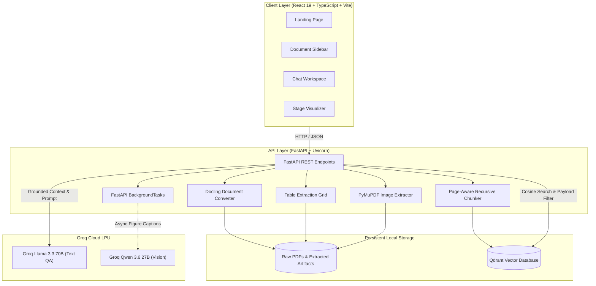

<p align="center">
  <picture>
    <source media="(prefers-color-scheme: dark)" srcset="frontend/src/assets/logo-horizontal-dark-theme.svg">
    <source media="(prefers-color-scheme: light)" srcset="frontend/src/assets/logo-horizontal-light-theme.svg">
    
  </picture>
</p>
  
<p align="center">
  <b>Transform complex, messy PDFs into structured, queryable knowledge.</b><br>
  Preserving layout hierarchies, structured tables, and visual diagrams with verifiable page citations.
  <br><br>
  
  
  
  
  
  
  
  
</p>

---

## 📑 Table of Contents
- [1. Problem Statement — Why We Built Anuvaad AI](#1-problem-statement--why-we-built-anuvaad-ai)
- [2. System Architecture](#2-system-architecture)
- [3. Complete Tech Stack](#3-complete-tech-stack)
- [4. Core Features & Unique Innovations](#4-core-features--unique-innovations)
- [5. Multimodal RAG Pipeline](#5-multimodal-rag-pipeline)
- [6. Quickstart & Local Setup](#6-quickstart--local-setup)
- [7. Comprehensive Documentation Index](#7-comprehensive-documentation-index)
- [8. Known Limitations](#8-known-limitations)
- [9. Engineering Lessons Learned](#9-engineering-lessons-learned)
- [10. Future Roadmap](#10-future-roadmap)
- [11. Disclaimer & Educational Purpose](#11-disclaimer--educational-purpose)

---

## 1. Problem Statement — Why We Built Anuvaad AI

Traditional Retrieval-Augmented Generation (RAG) pipelines treat PDFs as **flat, unformatted text strings**. In real-world enterprise documents (financial reports, research papers, legal agreements, and engineering specifications), this naive approach catastrophic fails:

1. **Table Scrambling**: Standard parsers dump table rows into comma-separated text. The association between columns and rows is broken, causing LLMs to hallucinate numbers or mix up metrics.
2. **Visual Blind Spots**: Key insights are often locked inside bar charts, architecture diagrams, scatter plots, and process schematics. Text-only RAG completely ignores these visual assets.
3. **Multi-Column Layout Destruction**: Scientific and corporate PDFs use two- or three-column layouts. Basic PDF parsers read across columns line-by-line, creating garbled, nonsensical sentences.
4. **Unverifiable Citations**: Generic chunking slices text into fixed character counts that span across page boundaries, making it impossible to give users exact, verifiable page numbers for auditing.

**Anuvaad AI** was built to solve these fundamental flaws by treating PDFs as **multimodal, structured entities**: preserving hierarchical Markdown, extracting cell-accurate tables, isolating visual figures with AI vision reasoning, and maintaining strict page boundaries for 100% auditable citations.

---

## 2. System Architecture

```
+-----------------------------------------------------------------------------------------+
|                               CLIENT LAYER (React 19 + Vite)                            |
|  [ Landing Page & Dropzone ]  [ Document Sidebar ]  [ Stage Visualizer ]  [ Chat Area ]  |
+--------------------------------------------+--------------------------------------------+
                                             | HTTP / REST
                                             v
+-----------------------------------------------------------------------------------------+
|                             API GATEWAY LAYER (FastAPI)                                 |
|         POST /upload           GET /documents          POST /reindex         POST /ask  |
|                                                                                         |
|       [ Document Ingestion Controller ]                 [ Query & QA Controller ]       |
|            |                        |                                |                  |
|            v                        v                                v                  |
|   (Docling Converter)     (FastAPI BackgroundTasks)        (Grounded Answer Engine)     |
|   - Layout Markdown         - Async Groq Vision              - Cosine Top-K Chunks      |
|   - 2D Structured Tables      Image Enrichment               - Strict Page Citations    |
|   - Page Text Mapping                                        - Insufficient Evidence    |
|   - PyMuPDF Figures                                            Refusal Guardrails       |
+------------+------------------------+--------------------------------+------------------+
             |                        |                                |
             v                        v                                v
+----------------------------+  +----------------------------+  +-------------------------+
|      LOCAL STORAGE         |  |   EXTERNAL ACCELERATION    |  |     QDRANT VECTOR DB    |
| storage/uploads/*.pdf      |  | Groq Llama 3.3 70B (Text)  |  | Collection: pdf_chunks  |
| storage/processed/*.md     |  | Groq Qwen 3.6 27B (Vision) |  | 384-dim all-MiniLM-L6   |
| storage/chunks/*.json      |  | (>250 tokens/sec speed)    |  | Filter: document_id     |
+----------------------------+  +----------------------------+  +-------------------------+
```



---

## 3. Complete Tech Stack

| Domain | Technology | Selection Rationale |
|---|---|---|
| **Frontend Framework** | **React 19** + **TypeScript** | Concurrent rendering, typed safety, modern hooks architecture. |
| **Build Tooling** | **Vite 8** | Sub-second HMR (Hot Module Replacement) and optimized tree-shaking. |
| **Styling & Design** | **Tailwind CSS v4** + HSL Tokens | Sleek dark/light theme tokens, responsive layouts, glassmorphism. |
| **Interactive Canvas** | **Three.js** | Ambient interactive particle network for high-aesthetic landing page. |
| **Icons & Visuals** | **Lucide React** | Consistent, lightweight SVG icon system. |
| **Backend Framework** | **FastAPI** + **Uvicorn** | Asynchronous execution, high throughput, automatic OpenAPI documentation. |
| **PDF Layout Engine** | **IBM Docling** | State-of-the-art layout analysis, reading-order preservation, markdown output. |
| **Table & Image Parsing** | **Docling Tables** + **PyMuPDF (`fitz`)** | Preserves 2D table grids and extracts high-resolution embedded figures. |
| **Chunking Engine** | **LangChain Text Splitters** | Page-aware recursive chunking with strict boundary enforcement. |
| **Embedding Model** | **`sentence-transformers/all-MiniLM-L6-v2`** | Fast 384-dim dense embeddings running locally on CPU with zero API costs. |
| **Vector Database** | **Qdrant (Embedded Engine)** | Local disk persistence, zero-overhead payload filtering on `document_id`. |
| **LLM Inference** | **Groq Cloud (`llama-3.3-70b-versatile`)** | LPU inference delivering $>250$ tokens/sec with strict evidence grounding. |
| **Multimodal Vision** | **Groq Vision (`qwen/qwen3.6-27b`)** | Deep visual reasoning on charts, plots, and schematics. |

---

## 4. Core Features & Unique Innovations

### ⚡ 1. Asynchronous Vision Enrichment
Instead of blocking document uploads for hundreds of seconds while calling remote vision models, Anuvaad AI delegates figure descriptions to FastAPI's `BackgroundTasks`. The user’s upload finishes in **~50 seconds** (a 67% reduction), while images are enriched in the background.

### 📊 2. Relational Table Preservation
Tables are parsed into true 2D matrices and serialized into structured Markdown tables with intact header associations (`| Col A | Col B |`). Questions like *"What was the operating expense in 2023 vs 2024?"* retrieve the entire table unit rather than orphaned numbers.

### 📌 3. Deterministic Page Citations
Chunks are created strictly within page boundaries. Retrieved context items explicitly carry their source `page_number`, allowing the LLM to output accurate `[Source: Page X]` citation pills that users can click to verify against source excerpts.

### 🔄 4. Complete Document Lifecycle Management
- **One-Click Re-indexing**: Supports re-chunking and re-embedding existing documents or initiating a full re-process (`full_reprocess=True`) directly from the UI.
- **Inline Safety Confirmation**: Deleting a document prompts an inline `Delete? [✓] [✕]` verification, purging all disk files, metadata, images, and Qdrant vectors.
- **Self-Healing Fallback**: If an unindexed document is queried, the backend detects the missing index and auto-chunks and indexes it on-the-fly.

### 🎨 5. Premium Glassmorphic User Interface
Built with modern design best practices: subtle micro-animations, animated progress accordions (`Uploading` $\rightarrow$ `Extracting` $\rightarrow$ `Chunking` $\rightarrow$ `Indexing` $\rightarrow$ `Ready`), Three.js interactive canvas, and adaptive dark/light themes.

---

## 5. Multimodal RAG Pipeline

```
[ Uploaded PDF ]
       │
       ├──► Docling Layout Engine ──────► Hierarchical Markdown (.md)
       │                                  └──► Page-Aware Text Map (.pages.json)
       │
       ├──► Table Grid Parser ──────────► Structured Table Matrices (.tables.json)
       │
       └──► PyMuPDF Raster Extractor ───► Extracted PNG Figures (images/)
                                          └──► BackgroundTasks: Groq Vision Captions
       │
[ Page-Aware Chunking ]
       ├── Text: 800-char window, 120 overlap, strict per-page boundaries
       └── Tables: Full Markdown serialization with preserved column headers
       │
[ Dense Vector Embedding ]
       └── SentenceTransformer: all-MiniLM-L6-v2 (384 dimensions, Cosine)
       │
[ Embedded Qdrant Database ]
       └── Stored in collection: 'pdf_chunks' with document_id payload filter
       │
[ Query & Hybrid Retrieval ]
       ├── Vector Search: Top-K text and table chunks filtered by active document
       └── Image Ranker: Keyword heuristic matching for relevant charts/diagrams
       │
[ Groq LPU Generation ]
       └── Llama 3.3 70B with strict citation guardrails [Source: Page X]
```

> For deep architectural explanations and alternatives evaluated (Docling vs PyPDF, Qdrant vs Chroma, Groq vs Local Ollama), see [docs/workflow.md](docs/workflow.md).

---

## 6. Quickstart & Local Setup

### 1. Prerequisites
- **Python**: 3.10+
- **Node.js**: 18+ & npm
- **Groq API Key**: Get a free key at [console.groq.com](https://console.groq.com)

### 2. Backend Setup
```bash
cd backend
python -m venv venv

# Windows
.\venv\Scripts\activate
# macOS/Linux: source venv/bin/activate

pip install -r requirements.txt
copy .env.example .env   # macOS/Linux: cp .env.example .env
```
Edit `backend/.env` and paste your `GROQ_API_KEY`:
```ini
GROQ_API_KEY=gsk_your_actual_key_here
```
Start the backend server:
```bash
python -m uvicorn app.main:app --reload --port 8000
```

### 3. Frontend Setup
In a new terminal window:
```bash
cd frontend
npm install
npm run dev
```

Open **`http://localhost:5173`** in your browser.

> For troubleshooting and detailed configuration options, see [setup.md](setup.md).

---

## 7. Comprehensive Documentation Index

Explore the dedicated documentation:

| Documentation File | Description |
|---|---|
| 📘 **[docs/workflow.md](docs/workflow.md)** | **Unified Technical Specification**: System Architecture, Multimodal RAG Pipeline, End-to-End Data Lifecycle, and Decision Matrices. |
| 🚀 **[setup.md](setup.md)** | **Local Setup & Troubleshooting Guide**: Step-by-step installation, environment configuration, and verification checklists. |

---

## 8. Known Limitations

1. **CPU Layout Extraction Time on 50+ Page Documents**: Docling's deep layout neural networks run on the CPU by default. While small documents (1–10 pages) parse in 15–40 seconds, large reports (50+ pages) can take 2–3 minutes.
2. **Local Qdrant File Lock**: Because Qdrant runs in embedded file-storage mode (`storage/qdrant/`), only **one** backend process can access the database files at a time. Concurrently running manual test scripts while Uvicorn is active will trigger a file lock warning.
3. **Complex Mathematical Formula Rendering**: While LaTeX formulas in markdown are preserved during parsing, highly stylized inline equation formatting may occasionally lose subscript alignment.

---

## 9. Engineering Lessons Learned

- **Offloading Vision to Background Tasks is Essential**: Running synchronous vision API calls on multiple extracted images during an HTTP upload bloated response times to over 150 seconds, triggering browser XHR timeouts. Decoupling image descriptions into `BackgroundTasks` reduced upload latency by **67%**.
- **Page-Aware Chunking Eliminates Cross-Page Hallucinations**: Standard recursive splitters that disregard page boundaries create chunks that merge the end of one section with the beginning of another on the next page. Slicing per page first guarantees deterministic citations.
- **Client Timeout Generosity for Multimodal Pipelines**: Standard HTTP client timeouts (e.g., 30s or 60s) are inadequate for deep PDF layout models. Extending client timeouts to 10 minutes prevents false network errors while maintaining live progress feedback.

---

## 10. Future Roadmap

- [ ] **Hybrid Retrieval (Dense + BM25)**: Combine `all-MiniLM-L6-v2` with `rank-bm25` and reciprocal rank fusion (RRF) for enhanced acronym and exact-keyword search.
- [ ] **Cross-Encoder Re-ranking**: Integrate a local BGE-Reranker or Cohere Rerank model to score the top-25 candidate passages before prompt injection.
- [ ] **Multi-Document Comparative Q&A**: Allow users to query across multiple selected documents simultaneously with cross-document comparative matrices.
- [ ] **Audio & Voice Interface**: Add voice question recording (via Whisper) and text-to-speech audio answers for accessibility.
- [ ] **Docker Compose Orchestration**: Single-command container deployment (`docker compose up`) for backend, frontend, and standalone Qdrant server.

---

## 11. Disclaimer & Educational Purpose

This project is created and maintained **strictly for educational, research, and learning purposes**. It is designed as an open learning exploration of multimodal document understanding, advanced RAG architectures, and AI system design.

---

<p align="center">
  Built with ❤️ for intelligent document understanding.
</p>