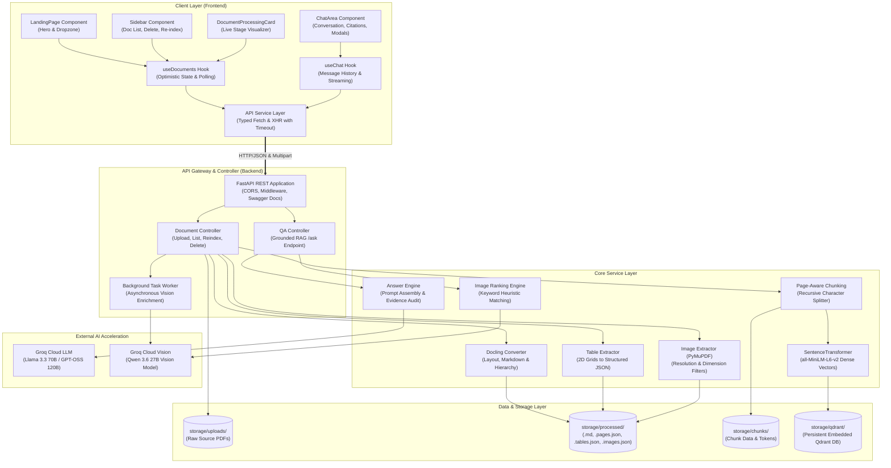

# Anuvaad AI — System Architecture

This document outlines the architectural blueprint of **Anuvaad AI** (DocuMind), detailing its layered structure, component interactions, data persistence boundaries, and technology selections.

---

## 1. High-Level Architecture Diagram



---

## 2. Layer-by-Layer Architectural Breakdown

### 2.1 Frontend Client Layer
The frontend is constructed with modern web standards, prioritizing high visual appeal, low latency, and deterministic state synchronization.

- **Framework**: React 19 + TypeScript + Vite.
- **Styling**: Tailwind CSS v4 coupled with curated HSL CSS custom properties (`--bg-surface`, `--text-brand`, `--accent-primary`). Supports dynamic Dark and Light theme switching.
- **Micro-Animations & Effects**: Interactive Three.js particle canvas background on the landing page, glassmorphic card overlays, animated step spinners, and inline confirmation dialogues.
- **Key Modules**:
  - `LandingPage.tsx`: Introductory interface with animated taglines, feature highlight cards, and an instant drag-and-drop ingestion zone with progressive status feedback.
  - `Sidebar.tsx`: Multi-document manager displaying real-time ingestion state, file metadata (pages, tables, figures), an inline safety-guarded delete confirmation (`Delete? [✓] [✕]`), and a one-click re-indexing trigger.
  - `DocumentProcessingCard.tsx`: An accordion visualizer that tracks processing progress across four distinct milestones (`Uploading` $\rightarrow$ `Extracting` $\rightarrow$ `Chunking` $\rightarrow$ `Indexing` $\rightarrow$ `Ready`).
  - `ChatArea.tsx`: Interactive chat view featuring message threads, copy-to-clipboard buttons, clickable source citation badges (`[Source: Page X]`), and modal previews for extracted document diagrams.
  - `useDocuments.ts`: Custom hook managing document lifecycles, optimistic UI additions, progressive step synchronization, and failure recoveries.
  - `useChat.ts`: Custom hook managing conversational turn state, multi-turn contexts, and document-specific query scoping.
  - `api.ts`: Centralized HTTP client using `fetch` for lightweight JSON queries and configurable `XMLHttpRequest` (with a 10-minute timeout) for large file uploads.

---

### 2.2 API & Ingestion Controller Layer
Built with **FastAPI**, providing high-performance asynchronous request handling, automatic OpenAPI/Swagger documentation, and Pydantic-enforced schemas.

- **FastAPI Endpoints**:
  | Route | Method | Purpose |
  |---|---|---|
  | `/` | `GET` | Service root health and application identity |
  | `/api/v1/health` | `GET` | Microservice health check probe |
  | `/api/v1/documents` | `GET` | Lists all documents with indexing state and chunk counts |
  | `/api/v1/documents/upload` | `POST` | Accepts PDF stream, runs Docling extraction, and auto-indexes chunks |
  | `/api/v1/documents/{id}/reindex` | `POST` | Re-indexes document into Qdrant; supports `full_reprocess=True` |
  | `/api/v1/documents/{id}` | `DELETE` | Purges document from disk, vector store, and chunk storage |
  | `/ask` | `POST` | Grounded question-answering with citation assembly |

- **Background Concurrency**:
  - Uses `fastapi.BackgroundTasks` to offload intensive tasks (such as visual description of embedded images) from the main request-response loop, reducing upload response times from ~150 seconds down to ~50 seconds.

---

### 2.3 AI & Multimodal Ingestion Pipeline Layer
Responsible for parsing unstructured PDFs into structured, queryable knowledge units.

1. **Docling Parser (`app/services/table_extraction.py` & `main.py`)**:
   - Converts arbitrary PDF layouts into clean Markdown.
   - Extracts bounding boxes and line provenance to preserve exact page numbers.
   - Parses complex multi-column grids and nested financial/scientific tables into 2D structures.
2. **PyMuPDF Image Extractor (`app/services/image_extraction.py`)**:
   - Extracts raw raster graphics embedded in the PDF.
   - Applies dimension filters ($\ge 60\times 60$ pixels) to discard irrelevant bullets, icons, and separators.
3. **Chunking Engine (`app/services/chunking.py`)**:
   - Uses `RecursiveCharacterTextSplitter` with 800-character windows and 120-character overlaps.
   - Strictly boundaries chunks per page to avoid context bleeding across document boundaries.
   - Converts extracted tables into Markdown tables so tabular row-column associations remain intact during vector search.
4. **Dense Vector Embedder (`app/services/vector_store.py`)**:
   - `SentenceTransformer("sentence-transformers/all-MiniLM-L6-v2")`.
   - Generates 384-dimensional dense vectors with L2 normalization for rapid cosine distance matching.

---

### 2.4 Vector & Artifact Storage Layer
All state in Anuvaad AI is persisted locally in a structured file system hierarchy, ensuring zero external database dependencies for local execution:

```
storage/
├── uploads/              # Raw original PDF files (<doc_id>.pdf)
├── processed/
│   ├── <doc_id>.json     # Master document metadata (pages, size, timestamp)
│   ├── <doc_id>.md       # Full converted Markdown text
│   ├── <doc_id>.pages.json  # Text broken down per page number
│   ├── <doc_id>.tables.json # Extracted structured tables with row/col grids
│   ├── <doc_id>.images.json # Extracted image metadata and vision captions
│   └── images/
│       └── <doc_id>/     # Extracted PNG visual assets
├── chunks/
│   └── <doc_id>.json     # Serialized text & table chunks ready for search
└── qdrant/               # Persistent embedded Qdrant vector database files
```

- **Qdrant Vector Database**:
  - Utilizes `qdrant-client` in embedded local storage mode (`QdrantClient(path=...)`).
  - Stores collection `pdf_chunks`.
  - Maintains payload indexes on `document_id` for instant filtered queries.

---

### 2.5 External LLM & Vision Reasoning Layer
Inference is accelerated via the Groq Cloud API, providing near-instantaneous Time To First Token (TTFT):

- **Text Reasoning & Synthesis**:
  - Model: `llama-3.3-70b-versatile` (or `openai/gpt-oss-120b`).
  - Governed by strict system prompts that penalize extrapolation and mandate `[Source: Page X]` tags.
- **Visual Diagram Reasoning**:
  - Model: `qwen/qwen3.6-27b` (Vision-enabled).
  - Used dynamically when the user's question relates to charts, architecture diagrams, or plots found within the document.
