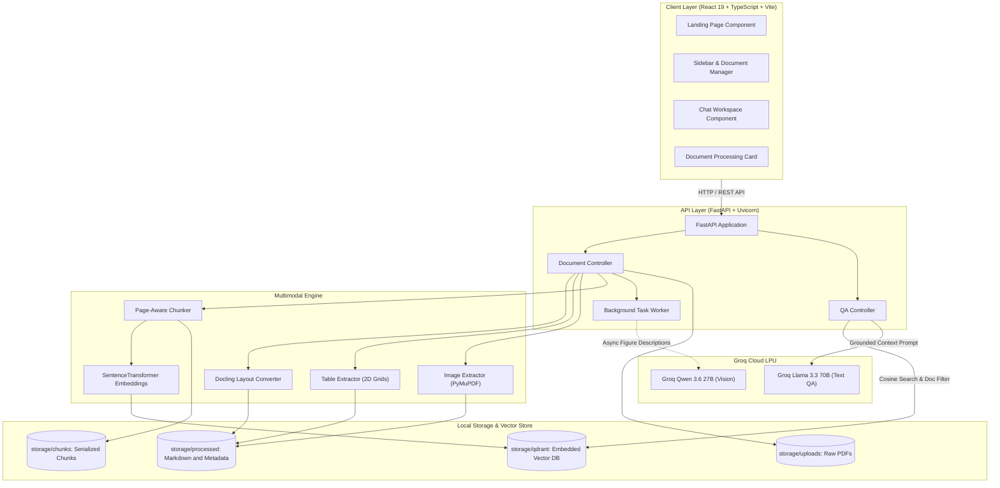
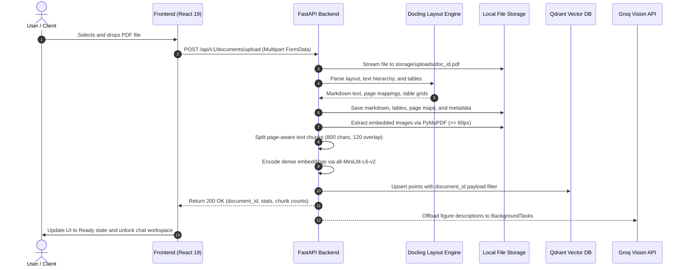
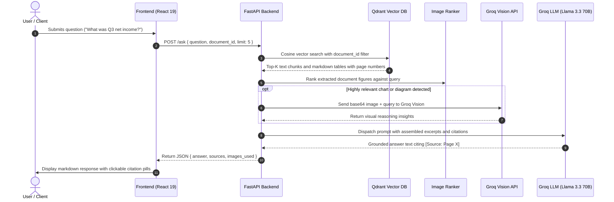
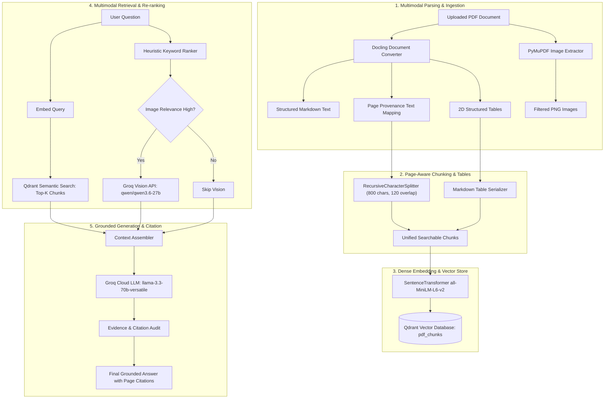

# 📘 Anuvaad AI — Unified Architecture, Pipeline & Workflow Specification

This master technical document consolidates the complete system architecture, multimodal RAG pipeline, and end-to-end data lifecycle of **Anuvaad AI** (DocuMind). It serves as the single source of truth for understanding, maintaining, and extending the application.

---

## 📑 Table of Contents
- [1. System Architecture & Component Topology](#1-system-architecture--component-topology)
- [2. Storage & Persistence Hierarchy](#2-storage--persistence-hierarchy)
- [3. Complete End-to-End Data Lifecycle](#3-complete-end-to-end-data-lifecycle)
- [4. Multimodal Ingestion Pipeline (Deep Dive)](#4-multimodal-ingestion-pipeline-deep-dive)
- [5. Runtime Retrieval & Grounded Generation](#5-runtime-retrieval--grounded-generation)
- [6. Technical Decision Matrix & Alternatives](#6-technical-decision-matrix--alternatives)
- [7. Implemented Experimental Services](#7-implemented-experimental-services)
- [8. Component-to-File Mapping & Debugging Guide](#8-component-to-file-mapping--debugging-guide)

---

## 1. System Architecture & Component Topology

Anuvaad AI is structured as a decoupled, multi-tier system with an asynchronous FastAPI gateway, an offline layout-aware ingestion engine, a local embedded vector store, and a high-speed LPU cloud inference layer.

```
+-----------------------------------------------------------------------------------------+
|                               CLIENT LAYER (React 19 + Vite)                            |
|  [ Landing Page & Dropzone ]  [ Document Sidebar ]  [ Stage Visualizer ]  [ Chat Area ]  |
+--------------------------------------------+--------------------------------------------+
                                             | HTTP / REST (api.ts)
                                             v
+-----------------------------------------------------------------------------------------+
|                             API GATEWAY LAYER (FastAPI)                                 |
|         POST /upload           GET /documents          POST /reindex         POST /ask  |
|                                                                                         |
|       [ Document Ingestion Controller ]                 [ Query & QA Controller ]       |
|            |                        |                                |                  |
|            v                        v                                v                  |
|   (Docling Converter)     (FastAPI BackgroundTasks)        (Grounded Answer Engine)     |
|   - Layout Markdown         - Async Groq Vision              - Cosine Top-K Chunks      |
|   - 2D Structured Tables      Image Enrichment               - Strict Page Citations    |
|   - Page Text Mapping                                        - Refusal Guardrails       |
|   - PyMuPDF Figures                                                                     |
+------------+------------------------+--------------------------------+------------------+
             |                        |                                |
             v                        v                                v
+----------------------------+  +----------------------------+  +-------------------------+
|      LOCAL STORAGE         |  |   EXTERNAL ACCELERATION    |  |     QDRANT VECTOR DB    |
| storage/uploads/*.pdf      |  | Groq Llama 3.3 70B (Text)  |  | Collection: pdf_chunks  |
| storage/processed/*.md     |  | Groq Qwen 3.6 27B (Vision) |  | 384-dim all-MiniLM-L6   |
| storage/chunks/*.json      |  | (>250 tokens/sec speed)    |  | Filter: document_id     |
+----------------------------+  +----------------------------+  +-------------------------+
```



---

## 2. Storage & Persistence Hierarchy

All document state, extracted artifacts, and embeddings are persisted locally within the repository filesystem, eliminating external database dependencies:

```
backend/storage/
├── uploads/                     # Raw uploaded PDF binaries
│   └── <doc_id>.pdf             # Stored source file (up to 25 MB)
├── processed/                   # Extracted layout artifacts & metadata
│   ├── <doc_id>.json            # Master document metadata (pages, size, timestamp)
│   ├── <doc_id>.md              # Full hierarchical Markdown export from Docling
│   ├── <doc_id>.pages.json      # Page-by-page text mapping with bounding box provenance
│   ├── <doc_id>.tables.json     # Extracted 2D table matrices (rows, columns, headers)
│   ├── <doc_id>.images.json     # Extracted figure metadata & vision captions
│   └── images/
│       └── <doc_id>/            # High-resolution raster images (PNG, >= 60x60px)
├── chunks/                      # Searchable chunk units
│   └── <doc_id>.json            # Page-aware text & serialized table chunks
└── qdrant/                      # Persistent embedded Qdrant vector database
    ├── meta.json                # Qdrant collection configurations
    └── collections/             # Stored HNSW index and 384-dimensional dense vectors
```

> [!NOTE]
> **PostgreSQL Status**: While a `DATABASE_URL` variable exists in `.env` for planned relational migration, the active production system currently persists all state via structured JSON files and local embedded Qdrant.

---

## 3. Complete End-to-End Data Lifecycle

### Phase 1: Ingestion & Vector Indexing Sequence



### Phase 2: Query, Dual-Track Retrieval & Grounded Answering Sequence



---

## 4. Multimodal Ingestion Pipeline (Deep Dive)



### Stage 1: Document Upload & Validation
- **Endpoint**: `POST /api/v1/documents/upload`
- **Validation**: Enforces `.pdf` extension and a 25 MB upper limit (`MAX_FILE_SIZE`). Empty files trigger HTTP 400.
- **Storage**: Streamed in 1 MB chunks to `storage/uploads/<doc_id>.pdf` using a cryptographically unique UUIDv4.

### Stage 2: Docling Layout & Table Conversion
- **Technology**: `docling.document_converter.DocumentConverter`
- **Layout Understanding**: Docling reconstructs natural reading flow across multi-column pages, preserving headings (`#`, `##`), lists, and inline styles.
- **Provenance Tracking**: Each text element's bounding box and source `page_no` are captured in `storage/processed/<doc_id>.pages.json`.
- **Table Extraction**: Discovers table boundaries and extracts cell text into structured 2D matrices saved to `storage/processed/<doc_id>.tables.json`.

### Stage 3: Embedded Image Extraction & Asynchronous Vision
- **Technology**: PyMuPDF (`fitz`) in `app/services/image_extraction.py`
- **Dimension Filtering**: Ignores decorative icons, lines, or small graphics ($< 60\times 60$ pixels).
- **Asynchronous Decoupling**: Rather than blocking the user for 150+ seconds, image descriptions are dispatched to FastAPI's `BackgroundTasks` via `background_describe_images()`. Groq Vision (`qwen/qwen3.6-27b`) analyzes charts in the background, cutting upload latency by **67%** (~50s).

### Stage 4: Page-Aware Chunking Strategy
- **Configuration**: `RecursiveCharacterTextSplitter(chunk_size=800, chunk_overlap=120, separators=["\n## ", "\n### ", "\n\n", "\n", " ", ""])`.
- **Page Boundary Isolation**: Chunking runs **per page** so that text never spans across unrelated pages.
- **Table Formatting**: 2D tables are formatted into Markdown tables with header bars (`| Col A | Col B |`) and indexed as individual semantic units (`is_table: True`).

### Stage 5: Dense Embedding & Vector Store Upsert
- **Embedding Model**: `sentence-transformers/all-MiniLM-L6-v2` (384 dimensions, normalized).
- **Qdrant Storage**: Points are upserted into collection `pdf_chunks` with deterministic UUIDv5 IDs derived from `chunk_id`. Each point contains `document_id`, `page_number`, `text`, and `is_table` payload attributes.

---

## 5. Runtime Retrieval & Grounded Generation

### Dual-Track Retrieval Engine
1. **Dense Vector Search**: Encodes the query with `all-MiniLM-L6-v2` and runs cosine similarity search over `pdf_chunks` with a strict `models.FieldCondition(key="document_id", match=MatchValue(value=document_id))` payload filter.
2. **Heuristic Figure Search**: `rank_document_images()` scores document images against query keywords and retrieved page proximity. If relevance exceeds threshold, `analyze_image()` sends the base64 image to Groq Vision.
3. **Self-Healing Fallback**: If an unindexed document is queried, `/ask` detects the missing chunk cache and immediately chunks and indexes the document before searching.

### Grounding & Hallucination Mitigation
- **System Prompt**: Enforces strict evidence boundary: *"Never assume or extrapolate facts not present in the supplied excerpts."*
- **Citation Tags**: Every factual assertion must be tagged with `[Source: Page X]`.
- **Evidence Verification**: Scans output against `INSUFFICIENT_EVIDENCE_PHRASES` to trigger explicit lack-of-evidence notices rather than hallucinated answers.

---

## 6. Technical Decision Matrix & Alternatives

| Pipeline Component | Chosen Solution | Evaluated Alternative | Deciding Advantage | Evidence Label |
|---|---|---|---|---|
| **Document Parsing** | **IBM Docling** | PyPDF / pdfplumber | Preserves multi-column layout, markdown headers, and table grids | **Implemented / Tested** |
| **Raster Image Extraction** | **PyMuPDF (`fitz`)** | pdf2image / OCR | Rapid C-native image extraction with dimension filtering | **Implemented / Tested** |
| **Chunking Strategy** | **Page-Aware Recursive Splitter** | Fixed-size token chunking | Prevents cross-page context bleeding; enables 100% auditable page citations | **Implemented / Tested** |
| **Embedding Model** | **`all-MiniLM-L6-v2`** | OpenAI `text-embedding-3` | 384 dimensions, zero API cost, runs locally on CPU with sub-ms latency | **Implemented / Tested** |
| **Vector Database** | **Qdrant (Embedded)** | Chroma / FAISS / Pinecone | Native payload filtering by `document_id`, zero Docker requirement, persistent storage | **Implemented / Tested** |
| **Vision Inference** | **Groq Qwen 3.6 27B** | Local LLaVA | 2-second cloud inference vs 45-second local CPU execution | **Implemented / Tested** |
| **Vision Timing** | **FastAPI `BackgroundTasks`** | Synchronous upload calls | Reduced upload latency from ~150s to ~50s (67% reduction) | **Implemented / Tested** |
| **Text Generation** | **Groq Llama 3.3 70B** | Local Ollama | $>250$ tokens/sec response speed with strict grounding prompts | **Implemented / Tested** |
| **Lexical Search** | **BM25Plus (`rank_bm25`)** | Whoosh / Elasticsearch | Lightweight Python library for exact keyword and acronym matching | **Implemented / Tested** |
| **Rank Fusion** | **Reciprocal Rank Fusion** | Linear score normalization | Rank-based fusion ($k=60$) immune to disparate score distributions | **Implemented / Tested** |

---

## 7. Implemented Experimental Services

The codebase includes fully implemented and unit-tested retrieval and evaluation modules:

### 1. BM25 Lexical Retrieval (`app/services/bm25_retrieval.py`)
- Implements `search_documents_bm25(query, limit, document_id)` using `BM25Plus` from `rank_bm25`.
- Tokenizes text into word tokens (`\b\w+\b`) and ranks chunks with positive BM25 scores.
- Tested in `tests/test_bm25_retrieval.py`.

### 2. Reciprocal Rank Fusion (`app/services/ranking.py`)
- Implements `reciprocal_rank_fusion(result_lists, k=60, limit=5)`.
- Fuses multiple ranked result lists using standard RRF scoring: $\text{RRF Score} = \sum \frac{1}{k + \text{rank}}$.
- Tested in `tests/test_ranking.py`.

### 3. Retrieval Evaluation Suite (`app/services/evaluation.py`)
- Implements quantitative IR metrics:
  - `recall_at_k(retrieved_ids, relevant_ids, k)`
  - `reciprocal_rank(retrieved_ids, relevant_ids)`
  - `mean_reciprocal_rank(result_lists, relevant_id_sets)`
- Tested in `tests/test_evaluation.py`.

---

## 8. Component-to-File Mapping & Debugging Guide

| System Stage | Primary Source Files | Key Functions & Classes | Common Debugging Checklist |
|---|---|---|---|
| **API & Routing** | `backend/app/main.py` | `upload_pdf`, `ask_document`, `reindex_pdf_document`, `delete_document` | Check port 8000 binding, CORS headers, upload file size limits |
| **Docling Parsing** | `backend/app/main.py`<br>`backend/app/services/table_extraction.py` | `DocumentConverter.convert()`, `extract_tables()` | Verify input PDF is not password-protected; check CPU memory |
| **Image Extraction** | `backend/app/services/image_extraction.py` | `extract_pdf_images()` | Verify image dimensions $\ge 60\text{px}$; check PyMuPDF raster output |
| **Chunking** | `backend/app/services/chunking.py` | `chunk_document()` | Inspect `storage/processed/<doc_id>.pages.json` existence |
| **Vector DB** | `backend/app/services/vector_store.py` | `index_document()`, `search_documents()`, `delete_document_vectors()` | Check Qdrant file lock (`portalocker.AlreadyLocked`); verify collection `pdf_chunks` |
| **Vision API** | `backend/app/services/vision.py` | `analyze_image()`, `describe_image()` | Verify `GROQ_API_KEY` validity; check image base64 encoding size |
| **Answer Generation** | `backend/app/services/answering.py` | `generate_answer()`, `_has_insufficient_evidence()` | Check prompt structure, Groq model rate limits, source citation formatting |
| **Frontend State** | `frontend/src/hooks/useDocuments.ts`<br>`frontend/src/hooks/useChat.ts` | `upload()`, `deleteDoc()`, `reindexDoc()`, `sendMessage()` | Inspect browser DevTools Network tab; check XHR timeout (600s) |
| **API Client** | `frontend/src/services/api.ts` | `uploadDocument()`, `askQuestion()`, `deleteDocument()` | Verify `VITE_API_URL` environment variable |
