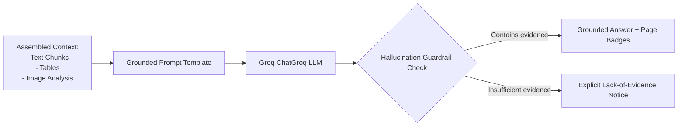

# Anuvaad AI — End-to-End Workflow Documentation

This document describes the complete data flow of **Anuvaad AI** (DocuMind), detailing how data travels through the system from the moment a user uploads a PDF to the final generation of a grounded answer with page citations.

---

## 1. High-Level Lifecycle Overview

```mermaid
sequenceDiagram
    autonumber
    actor User as User / Client
    participant FE as Frontend (React 19 + Vite)
    participant API as FastAPI Backend
    participant Docling as Docling & Layout Engine
    participant Storage as File & Artifact Storage
    participant VectorDB as Qdrant Vector Store
    participant Vision as Groq Vision API
    participant LLM as Groq LLM (Llama 3.3 / GPT-OSS)

    %% Upload & Extraction Phase
    rect rgb(20, 30, 45)
    Note over User, Storage: 1. Ingestion & Multimodal Extraction Phase
    User->>FE: Selects and drops PDF file
    FE->>API: POST /api/v1/documents/upload (Multipart FormData)
    API->>Storage: Stream file to storage/uploads/{doc_id}.pdf
    API->>Docling: Parse layout, hierarchical markdown, text & tables
    Docling-->>API: Markdown + Page texts + Grid tables
    API->>Storage: Save .md, .pages.json, .tables.json, .json metadata
    API->>Storage: Extract images via PyMuPDF to storage/processed/images/{doc_id}/
    API->>API: Auto-chunk and generate embeddings
    API->>VectorDB: Upsert points (text chunks + tables) with payload metadata
    API-->>FE: Return 200 OK (document_id, stats, chunk counts)
    API-)Vision: (Background Task) Asynchronously describe extracted figures
    end

    %% Question Answering Phase
    rect rgb(30, 25, 45)
    Note over User, LLM: 2. Query & Retrieval Phase
    User->>FE: Types question ("What is the net profit in Table 3?")
    FE->>API: POST /ask { question, document_id, limit: 5 }
    API->>VectorDB: Search nearest vectors (Cosine similarity + document_id filter)
    VectorDB-->>API: Return Top-K chunks & tables with source page metadata
    API->>Storage: Load candidate images from {doc_id}.images.json
    API->>API: Heuristic keyword ranking for relevant charts/diagrams
    opt Highly relevant image found
        API->>Vision: Groq Vision inspection of image + query
        Vision-->>API: Visual analysis of chart/diagram
    end
    end

    %% Synthesis & Delivery Phase
    rect rgb(25, 35, 25)
    Note over API, User: 3. Grounded Answer Synthesis Phase
    API->>LLM: Generate answer with strict grounding prompt (Context + Sources)
    LLM-->>API: Grounded response with [Source: Page X] citations
    API-->>FE: Return JSON { answer, sources, images_used }
    FE->>User: Render markdown answer, verified page badges & image modals
    end
```



---

## 2. Detailed Data Flow Stages

### Stage 1: Document Upload & Pre-flight Validation
1. **User Action**: The user selects a document or drags a PDF into the drop zone on either the Landing Page (`LandingPage.tsx`) or the Chat Sidebar (`Sidebar.tsx`).
2. **Client Validation**: The frontend checks the file type (`application/pdf`) and initiates an `XMLHttpRequest` via `uploadDocument` in `frontend/src/services/api.ts`.
3. **Upload Streaming**:
   - The file is streamed in 1 MB chunks to the FastAPI endpoint `POST /api/v1/documents/upload`.
   - File size is checked against the 25 MB limit (`MAX_FILE_SIZE`).
   - A unique UUID v4 `document_id` is generated for the session.
   - The raw PDF is written directly to disk at `storage/uploads/{document_id}.pdf`.

```mermaid
flowchart LR
    A[User PDF] --> B[Frontend Dropzone]
    B -->|XHR Stream with progress| C[FastAPI /upload]
    C -->|Validate <= 25MB| D[storage/uploads/{doc_id}.pdf]
    C -->|Trigger Processing| E[Docling Layout Engine]
```

---

### Stage 2: Multimodal Extraction & Parsing
Once the PDF is saved locally, Anuvaad AI extracts every modality using specialized engines:

1. **Docling Document Conversion**:
   - The document is converted using `docling.document_converter.DocumentConverter`.
   - **Markdown Export**: Structured markdown preserving headings (`#`, `##`), lists, bold/italic markup, and paragraph structure is exported to `storage/processed/{document_id}.md`.
   - **Page-Aware Text Mapping**: Text blocks are traversed with bounding box provenance (`item.prov`) to map every paragraph and heading to its original PDF `page_no`. Saved to `storage/processed/{document_id}.pages.json`.

2. **Structured Table Extraction**:
   - `extract_tables()` in `app/services/table_extraction.py` inspects table grids detected by Docling.
   - Each table's rows and columns are parsed into structured 2D arrays along with row count, column count, and page numbers.
   - Stored in `storage/processed/{document_id}.tables.json`.

3. **Embedded Image Extraction**:
   - `extract_pdf_images()` in `app/services/image_extraction.py` uses PyMuPDF (`fitz`) to locate all visual elements in the PDF.
   - Filters out icons, thin decorative lines, or logos (width $< 60$ px or height $< 60$ px).
   - Saves PNG files to `storage/processed/images/{document_id}/page_{page}_{index}.png`.
   - Metadata is recorded in `storage/processed/{document_id}.images.json`.

4. **Asynchronous Background Vision Enrichment**:
   - Rather than blocking the user's upload for hundreds of seconds, image descriptions are passed to FastAPI's `BackgroundTasks` via `background_describe_images()`.
   - In the background, Groq Vision (`qwen/qwen3.6-27b`) analyzes charts, plots, and architecture diagrams and updates the image metadata file with descriptive captions.

---

### Stage 3: Page-Aware Chunking & Vector Store Indexing

```mermaid
flowchart TD
    Pages[storage/processed/{doc_id}.pages.json] --> ChunkService[RecursiveCharacterTextSplitter]
    ChunkService -->|chunk_size=800, overlap=120| TextChunks[Page-Aware Text Chunks]
    
    Tables[storage/processed/{doc_id}.tables.json] --> TableFormatter[Markdown Table Serializer]
    TableFormatter --> TableChunks[Table Chunks with Headers]
    
    TextChunks & TableChunks --> Combine[Unified Chunk List]
    Combine --> SaveChunks[storage/chunks/{doc_id}.json]
    Combine --> DenseEmbed[SentenceTransformer 'all-MiniLM-L6-v2']
    DenseEmbed -->|384-dim Vectors| Qdrant[Qdrant Collection: 'pdf_chunks']
```

1. **Text Chunking**:
   - Uses `RecursiveCharacterTextSplitter` configured with separators `["\n## ", "\n### ", "\n\n", "\n", " ", ""]`.
   - Crucially, chunking is executed **per page** so that text never bleeds across unrelated pages.
   - Each chunk retains metadata: `document_id`, `original_filename`, `page_number`, `chunk_id`, and `chunk_index`.

2. **Table Chunking**:
   - Structured tables are formatted into Markdown tables with header bars (`| Col 1 | Col 2 |`).
   - Tables are indexed as standalone semantic units with metadata specifying `is_table: True`, `table_id`, and `page_number`.

3. **Dense Embedding & Vector Storage**:
   - Embeddings are computed locally using `SentenceTransformer("sentence-transformers/all-MiniLM-L6-v2")` (384 dimensions, normalized).
   - Points are upserted into the persistent local Qdrant collection `pdf_chunks` using a deterministic UUIDv5 based on `chunk_id`.

---

### Stage 4: User Query & Hybrid Retrieval

When a user submits a question in the chat interface:

```mermaid
flowchart TD
    UserQ[User Question: 'What was Q3 revenue?'] --> API[/ask Endpoint]
    API --> VectorSearch[Qdrant Semantic Search]
    VectorSearch -->|Filter by document_id, Cosine Distance| TopChunks[Top-K Text & Table Chunks]

    API --> ImageSearch[Image Ranking Heuristic]
    ImageSearch -->|Match query terms against figure captions| TopImages[Top Candidate Diagrams]

    TopImages --> HasVisionCheck{Candidate Image Relevance > Threshold?}
    HasVisionCheck -->|Yes| GroqVision[Groq Vision API: analyze_image]
    HasVisionCheck -->|No| SkipVision[Skip Vision Call]

    GroqVision --> ContextAssembler[Context Assembler]
    SkipVision --> ContextAssembler
    TopChunks --> ContextAssembler
```

1. **Semantic Vector Search**:
   - `search_documents()` encodes the query with `all-MiniLM-L6-v2`.
   - Performs cosine similarity search over `pdf_chunks` with a strict `models.FieldCondition(key="document_id", match=MatchValue(value=document_id))` filter.
   - Returns the top $K$ most relevant text blocks and markdown tables.

2. **Image Figure Retrieval**:
   - `rank_document_images()` scores extracted images based on word overlap with caption text and page proximity to retrieved text chunks.
   - If a diagram or chart is strongly relevant, `analyze_image()` sends the base64-encoded image to Groq Vision with the user's specific question.

3. **Self-Healing Fallback**:
   - If a document was uploaded but not yet vectorized (e.g., legacy upload or interrupted process), the `/ask` endpoint automatically detects the missing index and triggers instant on-the-fly chunking and indexing before searching.

---

### Stage 5: Grounded Answer Generation & Citation



1. **Prompt Grounding**:
   - The system prompt instructs the model to act as a rigorous document assistant.
   - Strict rule: **Never assume or extrapolate facts not present in the supplied excerpts.**
   - Every claim must be cited with `[Source: Page X]`.
2. **Inference**:
   - The query and assembled context are dispatched to Groq's high-speed inference engine running `llama-3.3-70b-versatile` or `openai/gpt-oss-120b`.
3. **Response Payload**:
   - The backend responds with:
     ```json
     {
       "answer": "According to the financial breakdown, net profit for Q3 was $4.2M [Source: Page 4]...",
       "sources": [
         {
           "page_number": 4,
           "chunk_id": "doc123_p4_c1",
           "text": "...",
           "score": 0.88,
           "is_table": true
         }
       ],
       "images_used": []
     }
     ```
4. **Client Rendering**:
   - The frontend parses the markdown text, renders source pills (`Page 4`), and allows users to click sources to view the raw excerpt that justified the answer.
